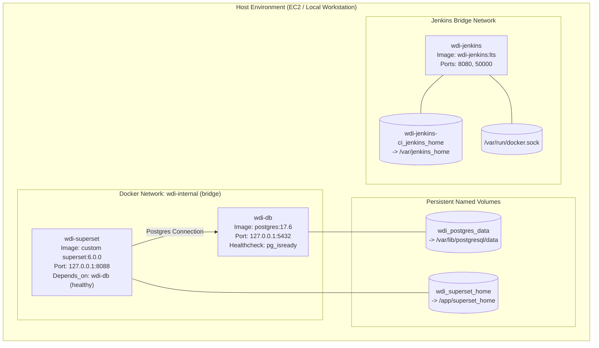

# Docker Architecture & Deployment Operations

---

## 1. Container Infrastructure Overview

The application and database tiers run as containerized microservices managed via **Docker Compose**:
1. **`wdi-db`:** PostgreSQL 17.6 relational data warehouse.
2. **`wdi-superset`:** Apache Superset 6.0.0 analytical visualization dashboard.
3. **`wdi-jenkins`:** Jenkins LTS CI/CD automation engine.



---

## 2. Container Service Matrix

| Service | Container Name | Base Image | Local Port Binding | Internal Network | Named Volume |
| :--- | :--- | :--- | :--- | :--- | :--- |
| **PostgreSQL** | `wdi-db` | `postgres:17.6` | `127.0.0.1:5432:5432` | `wdi-internal` | `wdi_postgres_data` |
| **Superset** | `wdi-superset` | Custom `apache/superset:6.0.0` | `127.0.0.1:8088:8088` | `wdi-internal` | `wdi_superset_home` |
| **Jenkins** | `wdi-jenkins` | Custom `jenkins/jenkins:lts` | `0.0.0.0:8080:8080` | Default Bridge | `wdi-jenkins-ci_jenkins_home` |

---

## 3. Dockerfile Analysis & Security Hardening

### 3.1 Apache Superset Custom Image (`superset-image/Dockerfile`)
```dockerfile
FROM apache/superset:6.0.0
USER root
# Pre-install PostgreSQL adapter
RUN pip install --no-cache-dir psycopg2-binary
# Enforce least-privilege non-root execution
USER superset
```
* **Security Control:** Enforces execution under the unprivileged `superset` user (UID 1000). The container has no root capabilities during request processing.

### 3.2 Jenkins LTS Image (`jenkins/Dockerfile`)
```dockerfile
FROM jenkins/jenkins:lts
USER root
RUN apt-get update && apt-get install -y --no-install-recommends \
    python3 python3-pip python3-venv git curl jq ca-certificates gnupg docker-ce-cli docker-compose-plugin
COPY terraform /usr/local/bin/terraform
RUN python3 -m pip install --no-cache-dir pytest polars sqlalchemy psycopg2-binary anyio
USER jenkins
RUN jenkins-plugin-cli --plugins "workflow-aggregator:latest" "git:latest" "junit:latest"
```
* **Packaging Control:** Bundles Python test dependencies, Docker CLI, Terraform binary, and Jenkins plugins inside the image layer, eliminating internet download dependencies during pipeline builds.

---

## 4. Environment Variables Configuration

Container credentials and configurations are managed via environment files:
* **Template File:** `.env.example` (Committed to Git, sanitized of all sensitive values).
* **Runtime Files:** `.env.compose` and `.env` (Excluded from Git via `.gitignore`).

### Mandatory Environment Variables:
```ini
# PostgreSQL
POSTGRES_DB=wdi_db
POSTGRES_USER=wdi_admin
POSTGRES_PASSWORD=<SECURE_PASSWORD>

# Superset
SUPERSET_SECRET_KEY=<SECURE_RANDOM_STRING>
SUPERSET_ADMIN_USERNAME=admin
SUPERSET_ADMIN_PASSWORD=<SECURE_PASSWORD>
SUPERSET_ADMIN_EMAIL=admin@wdi.local
```

---

## 5. Deployment Procedures & Automation Scripts

### 5.1 Remote Deployment Process (`scripts/deploy.sh`)
The deployment workflow copies project assets to the EC2 host and manages zero-loss updates:
1. Verifies SSH key readability (`keys/wdi-superset-admin`).
2. Syncs `docker-compose.yml`, `superset-image/`, and schema definitions to `/opt/wdi` on the remote instance.
3. Builds the custom Superset image remotely:
   ```bash
   docker compose --env-file /opt/wdi/.env.compose build
   ```
4. Launches the database container and waits for the health check (`pg_isready`):
   ```bash
   docker compose --env-file /opt/wdi/.env.compose up -d db
   ```
5. Initializes the database schema idempotently (`schema_safe.sql`) using `scripts/init_warehouse_schema.sh`.
6. Starts the Superset BI service:
   ```bash
   docker compose --env-file /opt/wdi/.env.compose up -d superset
   ```

### 5.2 Database Backup & Rollback Procedures
* **Create Backup (`scripts/backup_db.sh`):**
  Exports custom-format, compressed PostgreSQL dumps using `pg_dump -Fc`:
  ```bash
  ./scripts/backup_db.sh
  # Generates: backups/wdi_db-<TIMESTAMP>.dump and superset_metadata-<TIMESTAMP>.dump
  ```
* **Restore & Rollback (`scripts/restore_db.sh`):**
  Restores a verified snapshot if an erroneous migration or ETL corruption occurs:
  ```bash
  ./scripts/restore_db.sh backups/wdi_db-20261018T172446Z.dump
  ```
