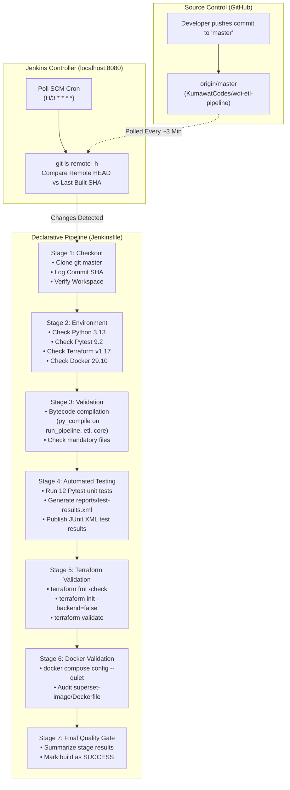

# Jenkins CI/CD Automation Pipeline Specification

---

## 1. Overview & Operational Model

The WDI ETL and Cloud Analytics platform employs a containerized **Jenkins LTS** CI/CD pipeline. The pipeline provides automated quality enforcement, regression testing, configuration compliance, and infrastructure validation on every code change before changes reach production environments.

* **Jenkins URL:** `http://localhost:8080`
* **Controller Container:** `wdi-jenkins`
* **Active Job:** `WDI-ETL-Pipeline`
* **Trigger Strategy:** **Poll SCM** (`H/3 * * * *`)
* **Pipeline Style:** Declarative Jenkinsfile located at the root of the repository.
* **Latest Verified Build:** Build #6 (**SUCCESS**, triggered automatically via Poll SCM).



---

## 2. Controller Architecture & Installation

### 2.1 Dockerized Deployment (`jenkins/docker-compose.yml`)
Jenkins runs as an isolated Docker service defined in `jenkins/docker-compose.yml`:
* **Base Image:** Built from custom `jenkins/Dockerfile` derived from `jenkins/jenkins:lts`.
* **Port Bindings:**
  * `8080:8080` (Jenkins Web UI and REST API).
  * `50000:50000` (Jenkins Inbound Agent port).
* **Storage Mount:** Named volume `wdi-jenkins-ci_jenkins_home` mounted to `/var/jenkins_home` to preserve build history, plugins, and job definitions across container restarts.
* **Socket Mount:** `/var/run/docker.sock` mounted to enable Docker CLI operations from inside the container.

### 2.2 Pre-Installed Tools in `jenkins/Dockerfile`
* **Python Runtime:** Python 3.13 with `pytest`, `polars`, `sqlalchemy`, `psycopg2-binary`, and `anyio`.
* **Container CLI:** `docker-ce-cli` and `docker-compose-plugin`.
* **IaC Engine:** Bundled standalone `terraform` binary (`/usr/local/bin/terraform`).
* **Jenkins Plugins:** Pre-installed via `jenkins-plugin-cli`:
  * `workflow-aggregator` (Pipeline engine).
  * `git` (Git SCM integration and polling).
  * `junit` (JUnit XML test result publisher).

### 2.3 Automated Bootstrap Scripts (`jenkins/init.groovy.d/`)
* **`01-security.groovy`:** Automatically provisions the administrative user (`admin`) and establishes Role-Based Matrix security.
* **`02-create-job.groovy`:** Automatically registers the `WDI-ETL-Pipeline` job using `CpsScmFlowDefinition` configured with `https://github.com/KumawatCodes/wdi-etl-pipeline.git`, branch `*/master`, and `H/3 * * * *` SCM polling. It checks whether the job already exists to guarantee idempotency and avoid overwriting user configurations on restart.

---

## 3. Declarative Jenkinsfile Deep Dive

The root [Jenkinsfile](file:///home/zenitsu/Data%20%26%20AI/projects/wdi-etl-pipeline/Jenkinsfile) implements seven strict quality stages:

### Stage 1: Checkout
Executes standard Git SCM checkout, confirms clean branch status, and logs the current commit hash:
```groovy
stage('Checkout') {
    steps {
        echo "Git Commit: $(git rev-parse --short HEAD)"
        echo "Git Branch: $(git rev-parse --abbrev-ref HEAD)"
    }
}
```

### Stage 2: Environment
Inspects the toolchain to ensure binary versions match expected operational baselines:
* Python version (`python3 --version`)
* Test runner version (`pytest --version`)
* Terraform version (`terraform version`)
* Docker CLI version (`docker --version`)

### Stage 3: Python Syntax & Config Validation
Performs fast static syntax checking by compiling all Python source modules to bytecode:
```bash
python3 -m py_compile run_pipeline.py etl/*.py core/*.py
```
Ensures schema definitions (`sql/schema_safe.sql`), Docker configurations (`docker-compose.yml`), and configuration templates (`.env.example`) exist.

### Stage 4: Automated Testing (Pytest Suite)
Runs the test suite across extraction, transformation, and dimensional loading modules:
```bash
pytest -v --junitxml=reports/test-results.xml tests/
```
The JUnit XML artifact is archived using Jenkins' `junit` post-action step, generating historical trend charts in the Jenkins UI.

### Stage 5: Infrastructure as Code (Terraform) Validation
Validates Terraform formatting and configuration without connecting to AWS or applying state:
1. `terraform -chdir=terraform fmt -check -diff`: Enforces canonical HCL formatting.
2. `terraform -chdir=terraform init -backend=false`: Initializes local provider plugins.
3. `terraform -chdir=terraform validate`: Confirms syntax, resource attribute types, and argument compliance.

### Stage 6: Docker & Container Validation
Audits Docker Compose definitions and container Dockerfiles:
1. `docker compose --env-file .env.example config --quiet`: Validates Compose file syntax and variable substitution.
2. `test -f superset-image/Dockerfile`: Verifies Dockerfile existence and enforces non-root execution (`USER superset`).

### Stage 7: Final Report & Quality Gate
Aggregates stage results, prints a clean ASCII summary audit, and issues a final `SUCCESS` status.

---

## 4. Source Control Integration (Poll SCM vs. Webhooks)

### Why Poll SCM was Selected
* **Zero Public Attack Surface:** Jenkins runs locally inside an internal Docker network.
* **No Reverse Proxies or Tunnels:** Standard webhooks require exposing internal ports to the internet using services like ngrok or Cloudflare Tunnel, introducing security risks.
* **Schedule:** `H/3 * * * *` causes Jenkins to query `git ls-remote` every ~3 minutes. When new commits appear on `origin/master`, a build is automatically queued with trigger cause `"Started by an SCM change"`.

### Handling Private Repositories
If the GitHub repository is converted from public to private:
1. Navigate to **Manage Jenkins** $\to$ **Credentials** $\to$ **Global credentials**.
2. Add a credential of type *Username with password*, setting the password to a GitHub Personal Access Token (PAT) with `repo` scope.
3. Reference the credential ID in Jenkins job configurations.

---

## 5. Troubleshooting & Bug History

| Issue | Root Cause | Engineering Solution |
| :--- | :--- | :--- |
| **Pytest Shebang Path Failure** | The local workspace path contained spaces (`Data & AI`), causing the Linux kernel to fail parsing the `#!` shebang in `.venv/bin/pytest`. | Replaced the static shebang in `.venv/bin/pytest` with a robust bash wrapper executing `"$DIR/python" -m pytest "$@"`. |
| **Python 3.12+ Collections Crash** | The obsolete third-party PyPI package `pathlib` was installed, which attempts to import `Sequence` from `collections` (removed in Python 3.10+). | Removed `pathlib>=1.0.1` from `pyproject.toml` and disabled the backport file in the virtual environment. Python's built-in standard library `pathlib` is used instead. |
| **Terraform Formatting Failure** | Trailing whitespace and alignment irregularities on line 113 of `terraform/main.tf`. | Formatted files canonically using `terraform fmt terraform/main.tf`. |
| **Clean SCM Checkout Provider Missing** | Running `terraform validate` on fresh Git checkouts failed because `.terraform` is excluded by `.gitignore`. | Added `terraform -chdir=terraform init -backend=false` to Stage 5 of the `Jenkinsfile` and configured a persistent plugin cache. |
| **Jenkins CSRF 403 Errors** | REST API calls without valid crumb headers were blocked by default CSRF protection. | Integrated cookie jar handling (`-c /tmp/cookies.txt` and `-b /tmp/cookies.txt`) with dynamic `Jenkins-Crumb` retrieval. |
