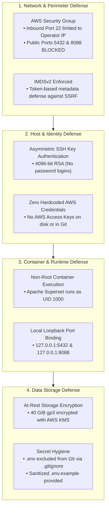

# Cloud Security Posture & Cost Optimization Architecture

---

## 1. Security Architecture & Threat Defense

The platform enforces defense-in-depth principles across the cloud, container, network, and application layers:



---

## 2. Implemented Security Controls vs. Recommendations

| Security Domain | Implemented Controls (Verified in Production) | Future Recommendations |
| :--- | :--- | :--- |
| **Identity & Secrets** | • Zero hardcoded AWS Access Keys.<br>• All secrets loaded via environment variables.<br>• `.env` excluded from version control.<br>• Sanitized `.env.example` committed. | Migrate local environment variables to AWS Secrets Manager or HashiCorp Vault. |
| **Network Exposure** | • Zero public ingress for PostgreSQL or Superset.<br>• Inbound SSH (Port 22) restricted to operator IP.<br>• Access to UI routed through authenticated SSH tunnel (`localhost:8088`). | Deploy an Application Load Balancer with AWS WAF and HTTPS TLS certificates. |
| **Host Security** | • IMDSv2 strictly enforced (`http_tokens = "required"`).<br>• SSH key-pair authentication (`wdi-superset-admin`).<br>• Ubuntu 24.04 LTS auto-updating security patches. | Integrate AWS Systems Manager (SSM) Session Manager to eliminate open SSH port 22 entirely. |
| **Container Security**| • Superset runs as non-root user `superset`.<br>• Isolated Docker bridge network `wdi-internal`.<br>• Docker compose file syntax validated in CI. | Integrate container image vulnerability scanning (Trivy / Clair) in the Jenkins pipeline. |
| **Data Protection** | • 40 GiB EBS volume encrypted at rest with AES-256.<br>• `delete_on_termination = false` guards against accidental termination. | Implement automated daily EBS snapshots across multiple availability zones. |

---

## 3. Cloud Cost Optimization & Financial Engineering

To guarantee zero budget overruns on student/academic AWS allocations, the platform implements an intentional **On-Demand Lifecycle Strategy**:

### 3.1 Financial Breakdown of Cloud Resources

| AWS Resource | Size / Specification | Monthly Estimate (24/7 Running) | Optimized Lifecycle Cost |
| :--- | :--- | :---: | :---: |
| **EC2 Compute (`m7i-flex.large`)** | 2 vCPU, 8 GiB RAM (Sydney: ~$0.103/hr) | ~$74.16 / month | **~$0.50 / month** (Run only during demo hours) |
| **EBS Root Storage (`gp3`)** | 40 GiB provisioned SSD ($0.096/GB-mo) | ~$3.84 / month | **~$3.84 / month** (Storage retained while stopped) |
| **CloudWatch Dashboard** | 1 Custom Dashboard (`WDI-ETL-Monitoring`) | ~$3.00 / month | **~$3.00 / month** (First 3 dashboards free on tier) |
| **CloudWatch Metric Alarm** | 1 Metric Alarm (`WDI-EC2-HighCPUUtilization`) | ~$0.10 / month | **~$0.10 / month** (First 10 alarms free on tier) |
| **CloudWatch Metrics** | Standard 5-min hypervisor metrics | $0.00 (Free Tier) | **$0.00** |
| **Total Cloud Expenditure** | — | **~$81.10 / month** | **< $5.00 / month** |

### 3.2 Operational Start/Stop Protocol
* **During Inactivity:** The instance is kept in `stopped` state. When stopped:
  - Compute hourly fees drop to **$0.00**.
  - Public IP charges are avoided.
  - The encrypted EBS volume and all stored database data remain fully preserved.
  - CloudWatch historical metrics and dashboard configurations remain active.
* **During Demo / Workload Sessions:**
  ```bash
  # 1. Start the EC2 host
  aws ec2 start-instances --instance-ids i-079665241b02585f8 --region ap-southeast-2

  # 2. Complete presentation / data operations...

  # 3. Cleanly power down immediately following session
  aws ec2 stop-instances --instance-ids i-079665241b02585f8 --region ap-southeast-2
  ```
