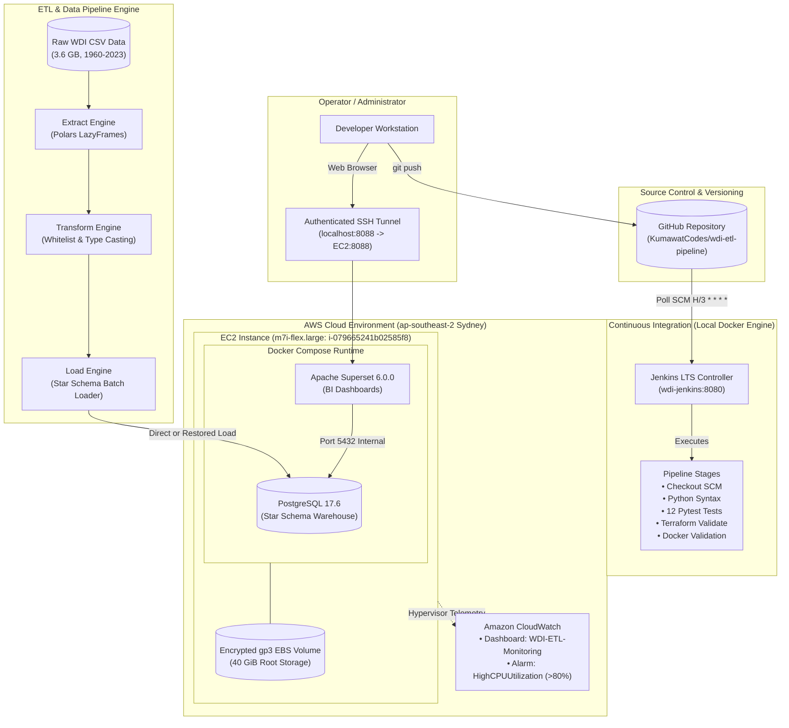
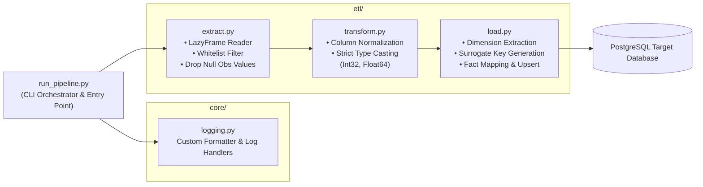
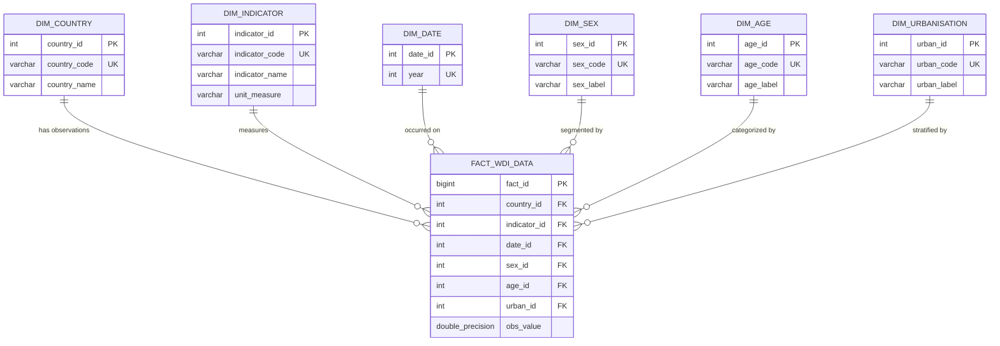
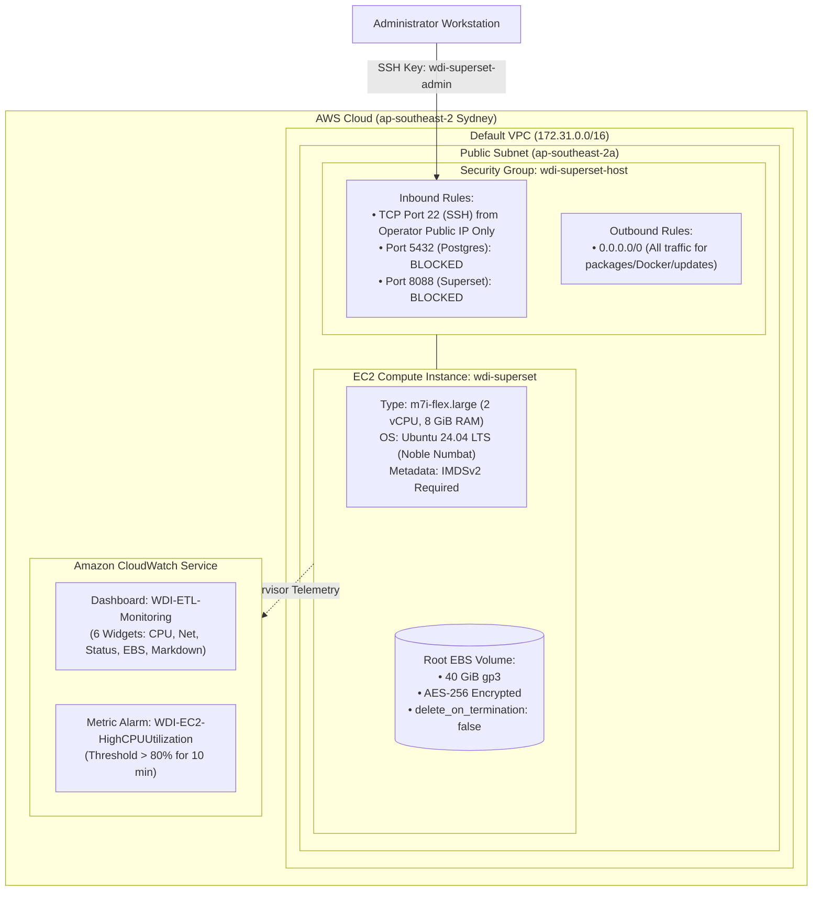
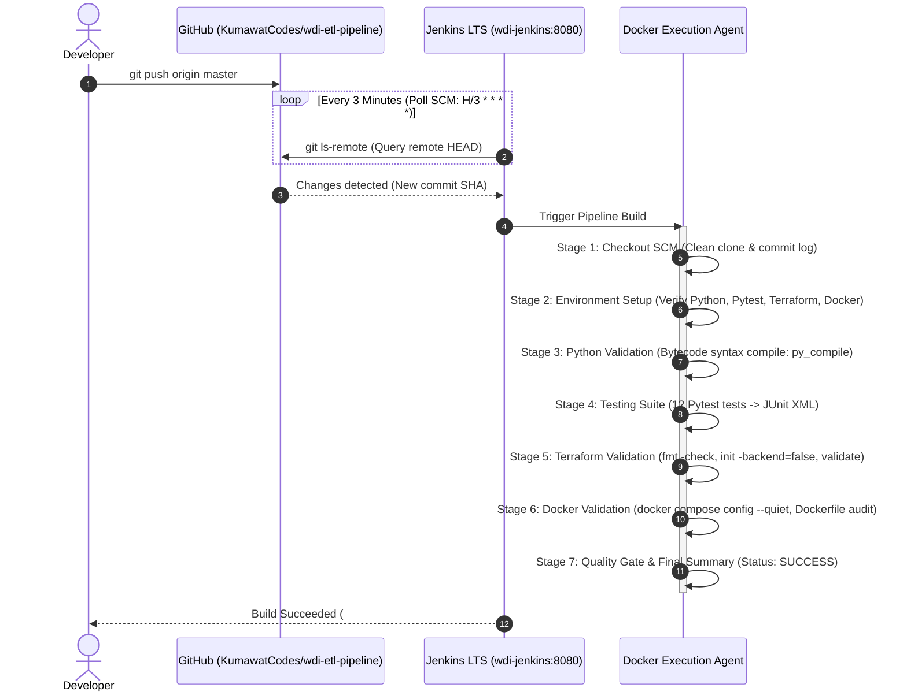
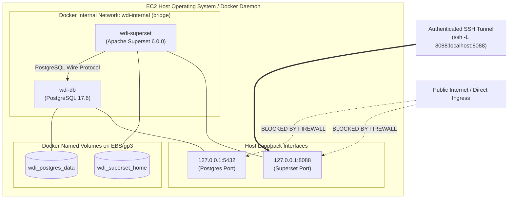

# System Architecture & Technical Design

---

## 1. High-Level Architecture Overview

The WDI ETL and Cloud Analytics platform adopts a modular, decoupled architecture consisting of three primary layers:
1. **Data Processing & Analytics Layer:** Local/Server execution of high-performance Polars extraction, relational modeling, and Apache Superset visualization.
2. **Cloud Infrastructure & Storage Layer:** AWS Sydney (`ap-southeast-2`) hosting an encrypted EC2 virtual machine, EBS persistent storage, and PostgreSQL warehouse.
3. **Continuous Integration & Observability Layer:** Jenkins LTS automating quality gates and testing via GitHub Poll SCM, coupled with Amazon CloudWatch tracking system health and resource consumption.



---

## 2. Application Architecture

The application tier is designed around a functional, modular Python architecture located under `etl/`, `core/`, and `run_pipeline.py`.



### 2.1 Extraction Subsystem (`etl/extract.py`)
* Leverages `polars.scan_csv()` to initiate streaming scan operations without loading the entire 3.6 GB file into memory.
* Applies predicate pushdown filtering for:
  - Year $\le 2023$.
  - 20 whitelisted indicator codes covering Demographics, GDP, Health, Education, and Energy.
  - Non-null `OBS_VALUE` filtering to eliminate sparse matrix blanks.

### 2.2 Transformation Subsystem (`etl/transform.py`)
* Standardizes column headers from SDMX format to warehouse naming conventions:
  - `REF_AREA` $\to$ `country_code`
  - `INDICATOR` $\to$ `indicator_code`
  - `TIME_PERIOD` $\to$ `year`
  - `OBS_VALUE` $\to$ `obs_value`
* Strictly casts data types using Polars expressions:
  - `year` cast from string/float $\to$ `pl.Int32`
  - `obs_value` cast to `pl.Float64`

### 2.3 Loading Subsystem (`etl/load.py`)
* Deconstructs the unified dataset into normalized dimension tables:
  1. `dim_country` (Unique `country_code`, `country_name`)
  2. `dim_indicator` (Unique `indicator_code`, `indicator_name`, `unit_measure`)
  3. `dim_date` (Unique `year`)
  4. `dim_sex` (`sex_code`, `sex_label`)
  5. `dim_age` (`age_code`, `age_label`)
  6. `dim_urbanisation` (`urban_code`, `urban_label`)
* Maps generated surrogate foreign keys back to the observation rows.
* Executes chunked database insertion into `fact_wdi_data` using SQLAlchemy and `psycopg2`.

---

## 3. Data Warehouse Dimensional Model (Star Schema)

The analytical data warehouse is structured as an **Extended Star Schema** optimized for online analytical processing (OLAP) queries:



---

## 4. Cloud Infrastructure Architecture (AWS Sydney)

The cloud environment is hosted in **AWS Sydney (`ap-southeast-2`)** and provisioned via declarative Terraform scripts:



---

## 5. CI/CD Architecture (Jenkins LTS)

The CI/CD pipeline implements a strict automated quality gate before any code is approved for production deployment.



---

## 6. Container Architecture & Service Orchestration

Docker Compose orchestrates the service runtime on the EC2 host:

| Service Name | Container Name | Image Source | Port Mapping | Internal Network | Storage Volumes |
| :--- | :--- | :--- | :--- | :--- | :--- |
| **Database** | `wdi-db` | `postgres:17.6` | `127.0.0.1:5432:5432` | `wdi-internal` | `wdi_postgres_data:/var/lib/postgresql/data` |
| **Analytics BI** | `wdi-superset` | Custom build from `superset-image/Dockerfile` | `127.0.0.1:8088:8088` | `wdi-internal` | `wdi_superset_home:/app/superset_home` |
| **CI/CD** | `wdi-jenkins` | Custom build from `jenkins/Dockerfile` | `0.0.0.0:8080:8080`, `50000:50000` | Host Bridge | `wdi-jenkins-ci_jenkins_home:/var/jenkins_home` |



---

## 7. Network Communication & Security Flow

1. **Inbound Traffic Rules:**
   - Security Group `wdi-superset-host` restricts inbound port 22 (SSH) strictly to the developer/operator's specific CIDR IP (`var.my_ip_cidr`).
   - Ports 5432 (Postgres) and 8088 (Superset) are **not exposed** in the Security Group.
   - Inside the EC2 host, container ports are bound strictly to `127.0.0.1`.
2. **Accessing Superset:**
   - The operator establishes an authenticated encrypted SSH tunnel:
     ```bash
     ssh -i keys/wdi-superset-admin -L 8088:localhost:8088 -N ubuntu@<EC2_PUBLIC_IP>
     ```
   - The user opens `http://localhost:8088` locally, securely bridging traffic through the tunnel into the container.
3. **Outbound Traffic Rules:**
   - Security Group allows outbound `0.0.0.0/0` enabling OS security updates, package retrieval, Docker image pulls, and CloudWatch metrics dispatching.
